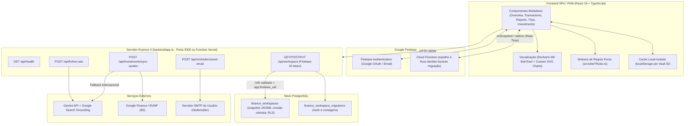

# Arquitetura Técnica, Motores de Regras e API REST — Minhas Economias BR

## 1. Visão Arquitetural Full-Stack

O projeto opera em arquitetura unificada **Node.js + Express 4 + React 19 (Vite)**:



---

## 2. Especificação da API REST (`backend/app.ts`)

### 2.1. `GET /api/health`
Verifica a disponibilidade do servidor Express e dos serviços integrados.

- **Resposta `200 OK`**:
```json
{
  "status": "ok",
  "environment": "development",
  "geminiConfigured": true,
  "services": {
    "liveFxSearch": true,
    "googleFinanceSync": true,
    "neonConfigured": true
  },
  "checkedAt": "2026-10-31T16:50:00.000Z"
}
```

### 2.2. Rotas autenticadas do workspace Neon

Todas exigem `Authorization: Bearer <Firebase ID token>`. A API valida o token
via Firebase Identity Toolkit e aplica o UID verificado no contexto RLS da
transação PostgreSQL.

- `GET /api/workspace`: carrega o snapshot da conta autenticada; retorna `404`
  antes da primeira importação.
- `POST /api/workspace/migrate`: importa o snapshot Firestore uma única vez,
  sem substituir uma linha Neon existente; retorna hash SHA-256 e contagens.
- `PUT /api/workspace`: salva com `expectedRevision`; conflito retorna `409`.

O Firestore segue como espelho/contingência e mantém o compartilhamento familiar
durante a primeira fase. Não desative esse fluxo até validar a migração e projetar
autorização explícita para cofres compartilhados.

---

### 2.3. `POST /api/fx/live-rate`
Consulta a cotação comercial em tempo real de uma moeda estrangeira (`USD`, `EUR`, `GBP`, `CAD`, `CHF`, `ARS`, `CLP`, `JPY`) frente ao Real Brasileiro (`BRL`) usando **Gemini Google Search Grounding**.

- **Payload de Requisição**:
```json
{
  "currency": "EUR"
}
```
- **Resposta `200 OK`**:
```json
{
  "currency": "EUR",
  "targetCurrency": "BRL",
  "commercialRateBrl": 6.1845,
  "summaryText": "Cotação comercial atual: 1 EUR = R$ 6,1845.",
  "fetchedAt": "2026-10-31T16:50:00.000Z",
  "sources": [
    {
      "uri": "https://www.google.com/finance/quote/EUR-BRL",
      "title": "EUR/BRL - Google Finance"
    }
  ]
}
```

---

### 2.4. `POST /api/investments/sync-quotes`
Sincroniza em lote (até 20 tickers por requisição) os preços atuais de mercado e a variação diária (`%`) de Ações B3, FIIs e ETFs diretamente do **Google Finance (`:BVMF`)**, com fallback via **Google Search Grounding** para ativos internacionais.

- **Payload de Requisição**:
```json
{
  "tickers": ["PETR4", "HGLG11", "IVVB11"]
}
```
- **Resposta `200 OK`**:
```json
{
  "quotes": [
    {
      "ticker": "PETR4",
      "priceBrl": 38.45,
      "changePercent": 1.25,
      "name": "Petróleo Brasileiro S.A. - Petrobras",
      "sourceUri": "https://www.google.com/finance/quote/PETR4:BVMF?hl=pt-BR"
    }
  ],
  "fetchedAt": "2026-10-31T16:50:00.000Z",
  "sources": []
}
```

---

### 2.5. `POST /api/reminders/send-email`
Dispara o resumo diário/semanal/mensal de pendências financeiras e vencimentos de faturas por e-mail utilizando as credenciais SMTP configuradas pelo usuário (`nodemailer`).

- **Payload de Requisição**:
```json
{
  "to": "wesley.diaslima@gmail.com",
  "subject": "[Minhas Economias BR] Resumo de Vencimentos",
  "textBody": "Resumo em texto puro...",
  "htmlBody": "<div>Resumo HTML...</div>",
  "recurrence": "daily",
  "preferredTime": "08:00",
  "smtp": {
    "host": "smtp.gmail.com",
    "port": 587,
    "user": "wesley.diaslima@gmail.com",
    "pass": "app_password_16_chars",
    "secure": false
  }
}
```

---

## 3. Motores de Regras de Negócio (`src/utils/`)

Toda a lógica matemática e contábil é desacoplada da árvore React e coberta por **69 testes unitários** (`node:test`):

1. **`src/utils/financeRules.ts` (`src/utils/financeRules.test.ts`)**:
   - `createTransactionBatch`: Geração de lançamentos únicos, parcelados (com ajuste de centavos na 1ª parcela) e fixos recorrentes.
   - `resolveCreditCardInvoiceMonth`: Determina a competência da fatura com base no dia da compra vs. `closingDay`.
   - `payCreditCardInvoice` & `reverseCreditCardInvoicePayment`: Baixa total ou parcial de fatura com criação automática de saldo residual e reversão segura.
   - `calculateMonthlySummary` & `calculateAccountBalances`: Saldo realizado, saldo projetado, receitas, despesas e taxa de poupança.
   - `calculatePeriodReport` & `calculateSixMonthComparativeSeries`: Séries históricas multimensais, comparativo dos últimos 6 meses para o gráfico Recharts e indicadores de saúde financeira.
   - `calculate503020Rule`: Alocação orçamentária 50% Essenciais / 30% Estilo de Vida / 20% Futuro.
   - `simulateFixedIncomeBR`: Simulador de juros compostos líquidos de IR para CDI, Selic, LCI/LCA e Poupança.

2. **`src/utils/uxEnhancementRules.ts` (`src/utils/uxEnhancementRules.test.ts`)**:
   - `predictCategoryFromDescription` & `getCategorySuggestionsForDescription`: Motor de sugestão inteligente de categoria e subcategoria baseado em similaridade textual, frequência e recência.
   - `calculateBudgetImpactPreview`: Prévia de impacto orçamentário antes de confirmar um lançamento.
   - `calculateMonthBurnRateMarker`: Ritmo de consumo do orçamento vs. dias corridos do mês.
   - `anticipateCardInstallments` & `reverseAnticipatedInstallments`: Antecipação de parcelas de cartão com desconto financeiro.
   - `calculateWeeklyCashPulse`: Pulso de caixa em 5 semanas com detecção de pico de despesas.
   - `calculateAccountStatementWithRunningBalance`: Extrato cronológico com saldo corrido após cada lançamento.

3. **`src/utils/travelRules.ts` (`src/utils/travelRules.test.ts`)**:
   - `calculateConvertedBrlAmount`: Conversão cambial com IOF parametrizado (`1.1%` Conta Global, `3.38%` Cartão Internacional, `0%` Espécie).
   - `calculateTripWeightedAverageRate`: Cálculo do VET médio ponderado dos lotes de câmbio.
   - `calculateTripExpenseShares` & `calculateTripAnalytics`: Motor Splitwise de divisão (`equal`, `exact`, `percentage`, `shares`, `individual`) e simplificação de dívidas entre viajantes.
   - `calculateExchangeSavingsAnalysis`: Economia cambial gerada pelos lotes vs. câmbio comercial de referência.
   - `runFinancialIntegrityAudit` & `sanitizeAndRepairFinancialState`: Auditoria e autorreparo da Fonte Única de Dados (SSOT).

4. **`src/utils/reconciliationRules.ts` (`src/utils/reconciliationRules.test.ts`)**:
   - `parseOfxContent` & `parseCsvBankStatement`: Importação de arquivos bancários `.ofx` e `.csv`.
   - `matchImportedEntriesWithExisting`: Conciliação automática por `FITID`, valor exato e janela de tolerância de data.

5. **`src/utils/reminderRules.ts` (`src/utils/reminderRules.test.ts`)**:
   - `generateFinancialReminders`, `shouldTriggerDailyNotification`, `shouldTriggerEmailNotification` e `formatEmailReminderDigest`.
