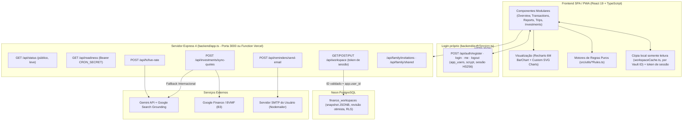

# Arquitetura Técnica, Motores de Regras e API REST — Minhas Economias BR

## 1. Visão Arquitetural Full-Stack

O projeto opera em arquitetura unificada **Node.js + Express 4 + React 19 (Vite)**:



---

## 2. Especificação da API REST (`backend/app.ts`)

### 2.1. `GET /api/status` e `GET /api/readiness`

`GET /api/status` é público e informa somente se a API e as configurações
necessárias estão presentes. Não abre conexão nem executa consultas no Neon;
`services.neon: "not_checked"` significa que a disponibilidade do banco não
foi medida. O diagnóstico da interface combina esse estado com o estado real da
última sincronização.

`GET /api/readiness` verifica a conexão, a tabela operacional e os privilégios
da role do Neon. Exige `Authorization: Bearer <CRON_SECRET>` e retorna `401`
antes de conectar ao banco quando o segredo está ausente ou não corresponde.
O cron diário da Vercel aponta para essa rota e envia o bearer secret configurado
no ambiente do projeto.

- **Resposta `200 OK`**:
```json
{
  "status": "ok",
  "environment": "development",
  "geminiConfigured": true,
  "services": {
    "liveFxSearch": true,
    "googleFinanceSync": true,
    "authConfigured": true,
    "neonConfigured": true,
    "neon": "not_checked"
  },
  "checkedAt": "2026-10-31T16:50:00.000Z"
}
```

### 2.2. Rotas autenticadas do workspace Neon

Todas exigem `Authorization: Bearer <token de sessão>`. A API valida a
assinatura HS256 e a expiração do token e confere o `token_version` em
`app_users` a cada requisição (logout revoga todos os tokens anteriores); depois
aplica o ID verificado no contexto RLS da transação PostgreSQL. Sessão inválida,
expirada ou revogada retorna `401`; falha ao consultar o banco ou segredo ausente
retorna `503`.

- `GET /api/workspace`: carrega o snapshot da conta autenticada; retorna `404`
  quando ainda não há linha para a conta.
- `POST /api/workspace`: cria o workspace inicial usando `INSERT ... ON CONFLICT DO NOTHING`, sem substituir dados existentes.
- `PUT /api/workspace`: salva com `expectedRevision`; conflito retorna `409`.

Se a conta ainda não tiver workspace, o registro inicial é criado no Neon.
Convites e lançamentos compartilhados usam tabelas Neon próprias.

### 2.2.1. Autenticação (`/api/auth/*`)

| Rota | Acesso | Função |
|---|---|---|
| `POST /api/auth/register` | público, 10 tentativas/h por IP | Cria conta (`{email, password, name?}`; senha 8–200 caracteres). `201` com `{token, user}`; `409` se o e-mail já existe |
| `POST /api/auth/login` | público, 8 falhas/15 min por IP+e-mail | `200` com `{token, user}`; `401` e-mail/senha incorretos; `429` bloqueio temporário |
| `GET /api/auth/me` | sessão | Revalida a sessão e devolve novo token e dados da conta |
| `POST /api/auth/logout` | sessão | Incrementa `token_version` (revoga todos os tokens); `204` |

Sem verificação de e-mail: o convite familiar dentro do sistema é o vínculo entre contas.

### 2.2.2. Família e compartilhamento (`/api/family/*`, sessão obrigatória)

- `GET/POST /api/family/invitations`: lista e cria convites.
- `POST /api/family/invitations/:invitationId/respond` e `/revoke`: aceitar/recusar e revogar (`404` convite inexistente para a conta; `409` convite já respondido).
- `GET/PUT /api/family/shared`: lê e sincroniza despesas compartilhadas (cota validada em centavos; `400` se inválida).

---

### 2.3. `POST /api/fx/live-rate`
Consulta a cotação comercial em tempo real de uma moeda estrangeira (`USD`, `EUR`, `GBP`, `CAD`, `CHF`, `ARS`, `CLP`, `JPY`) frente ao Real Brasileiro (`BRL`) usando **Gemini Google Search Grounding**.

- **Payload de Requisição**:
```json
{
  "currency": "EUR"
}
```
- **Resposta `200 OK`**:
```json
{
  "currency": "EUR",
  "targetCurrency": "BRL",
  "commercialRateBrl": 6.1845,
  "summaryText": "Cotação comercial atual: 1 EUR = R$ 6,1845.",
  "fetchedAt": "2026-10-31T16:50:00.000Z",
  "sources": [
    {
      "uri": "https://www.google.com/finance/quote/EUR-BRL",
      "title": "EUR/BRL - Google Finance"
    }
  ]
}
```

---

### 2.4. `POST /api/investments/sync-quotes`
Sincroniza em lote (até 20 tickers por requisição) os preços atuais de mercado e a variação diária (`%`) de Ações B3, FIIs e ETFs diretamente do **Google Finance (`:BVMF`)**, com fallback via **Google Search Grounding** para ativos internacionais.

- **Payload de Requisição**:
```json
{
  "tickers": ["PETR4", "HGLG11", "IVVB11"]
}
```
- **Resposta `200 OK`**:
```json
{
  "quotes": [
    {
      "ticker": "PETR4",
      "priceBrl": 38.45,
      "changePercent": 1.25,
      "name": "Petróleo Brasileiro S.A. - Petrobras",
      "sourceUri": "https://www.google.com/finance/quote/PETR4:BVMF?hl=pt-BR"
    }
  ],
  "fetchedAt": "2026-10-31T16:50:00.000Z",
  "sources": []
}
```

---

### 2.5. `POST /api/reminders/send-email`
Dispara o resumo diário/semanal/mensal de pendências financeiras e vencimentos de faturas utilizando as credenciais SMTP fornecidas pelo usuário (`nodemailer`). Exige sessão (`Authorization: Bearer <token de sessão>`), restringe destinos a hostnames públicos e portas SMTP compatíveis, e exige TLS. As credenciais podem estar incluídas nas configurações persistidas no Neon. Responde `502` se o servidor SMTP recusar a entrega.

- **Payload de Requisição**:
```json
{
  "to": "usuario@exemplo.com",
  "subject": "[Minhas Economias BR] Resumo de Vencimentos",
  "textBody": "Resumo em texto puro...",
  "htmlBody": "<div>Resumo HTML...</div>",
  "recurrence": "daily",
  "preferredTime": "08:00",
  "smtp": {
    "host": "smtp.gmail.com",
    "port": 587,
    "user": "usuario@exemplo.com",
    "pass": "app_password_16_chars",
    "secure": false
  }
}
```

---

## 3. Motores de Regras de Negócio (`src/utils/`)

Toda a lógica matemática e contábil é desacoplada da árvore React e coberta pelos testes automatizados (`bun test`, arquivos `*.test.ts(x)`; 575 testes em 77 arquivos em 12/11/2026):

1. **`src/utils/financeRules.ts` (`src/utils/financeRules.test.ts`)**:
   - `createTransactionBatch`: Geração de lançamentos únicos, parcelados (com ajuste de centavos na 1ª parcela) e fixos recorrentes.
   - `resolveCreditCardInvoiceMonth`: Determina a competência da fatura com base no dia da compra vs. `closingDay`.
   - `payCreditCardInvoice` & `reverseCreditCardInvoicePayment`: Baixa total ou parcial de fatura com criação automática de saldo residual e reversão segura.
   - `calculateMonthlySummary` & `calculateAccountBalances`: Saldo realizado, saldo projetado, receitas, despesas e taxa de poupança.
   - `calculatePeriodReport` & `calculateSixMonthComparativeSeries`: Séries históricas multimensais, comparativo dos últimos 6 meses para o gráfico Recharts e indicadores de saúde financeira.
   - `calculate503020Rule`: Alocação orçamentária 50% Essenciais / 30% Estilo de Vida / 20% Futuro.
   - `simulateFixedIncomeBR`: Simulador de juros compostos líquidos de IR para CDI, Selic, LCI/LCA e Poupança.

2. **`src/utils/uxEnhancementRules.ts` (`src/utils/uxEnhancementRules.test.ts`)**:
   - `predictCategoryFromDescription` & `getCategorySuggestionsForDescription`: Motor de sugestão inteligente de categoria e subcategoria baseado em similaridade textual, frequência e recência.
   - `calculateBudgetImpactPreview`: Prévia de impacto orçamentário antes de confirmar um lançamento.
   - `calculateMonthBurnRateMarker`: Ritmo de consumo do orçamento vs. dias corridos do mês.
   - `anticipateCardInstallments` & `reverseAnticipatedInstallments`: Antecipação de parcelas de cartão com desconto financeiro.
   - `calculateWeeklyCashPulse`: Pulso de caixa em 5 semanas com detecção de pico de despesas.
   - `calculateAccountStatementWithRunningBalance`: Extrato cronológico com saldo corrido após cada lançamento.

3. **`src/utils/travelRules.ts` (`src/utils/travelRules.test.ts`)**:
   - `calculateConvertedBrlAmount`: Conversão cambial com IOF parametrizado (`1.1%` Conta Global, `3.38%` Cartão Internacional, `0%` Espécie).
   - `calculateTripWeightedAverageRate`: Cálculo do VET médio ponderado dos lotes de câmbio.
   - `calculateTripExpenseShares` & `calculateTripAnalytics`: Motor Splitwise de divisão (`equal`, `exact`, `percentage`, `shares`, `individual`) e simplificação de dívidas entre viajantes.
   - `calculateExchangeSavingsAnalysis`: Economia cambial gerada pelos lotes vs. câmbio comercial de referência.
   - `runFinancialIntegrityAudit` & `sanitizeAndRepairFinancialState`: Auditoria e autorreparo da Fonte Única de Dados (SSOT).

4. **`src/utils/reconciliationRules.ts` (`src/utils/reconciliationRules.test.ts`)**:
   - `parseOfxContent` & `parseCsvBankStatement`: Importação de arquivos bancários `.ofx` e `.csv`.
   - `matchImportedEntriesWithExisting`: Conciliação automática por `FITID`, valor exato e janela de tolerância de data.

5. **`src/utils/reminderRules.ts` (`src/utils/reminderRules.test.ts`)**:
   - `generateFinancialReminders`, `shouldTriggerDailyNotification`, `shouldTriggerEmailNotification` e `formatEmailReminderDigest`.

6. **Módulos adicionados depois (resumo)**:
   - `src/utils/financeRules.ts`: centraliza as regras monetárias. Saldo total, investimentos e patrimônio partem da posição de hoje (`calculateCurrentPosition`); gasto, orçamento, 50/30/20 e DRE usam o mês da compra/parcela, enquanto faturas e caixa usam o vencimento. Despesa fixa no cartão aparece no calendário/extrato só no primeiro lançamento do grupo (`getPurchaseTransactionsForMonth`); `getInstallmentAndRecurringItemsForMonth` alimenta o card "Parcelados & Recorrentes".
   - `src/utils/sharedFinanceRules.ts` e `sharedSettlementReceipts.ts`: seleção, resumo, liquidação e reabertura de compartilhamentos; cada acerto recebe `sharedSettlementId`; recibos bancários locais ficam em `sharedSettlementReceiptsJson` no workspace do titular.
   - `src/utils/investmentRules.ts`: aportes/resgates como transferência banco↔ativo, aporte de meta vinculado e bloqueio de exclusão de ativo com saldo, histórico ou meta (`getInvestmentDeletionRestriction`).
   - `src/utils/workspaceCache.ts`, `workspaceSession.ts`, `workspaceSyncRecovery.ts`: abertura imediata com a cópia local e substituição silenciosa pelo Neon; recuperação de erro de carga/sincronização.
   - `src/utils/fullBackup.ts`: exportação/importação JSON (versões 3 a 6; a v6 exige `ownerUserId` igual à conta autenticada).
   - `src/pwa/updateGate.ts` e `PwaUpdateNotice.tsx`: atualização automática silenciosa do PWA (checa a cada 10 min, ao voltar à aba e ao reconectar; só aplica sem campo alterado, janela aberta ou gravação em andamento).

---

## 4. Testes e CI

- Local: `bun run lint` (`tsc --noEmit`), `bun test` e `bun run build` (Vite + PWA).
- `.github/workflows/ci.yml`: job `postgres` (PostgreSQL 17 real com `scripts/qa-postgres.ts`: API, RLS, acertos, readback e revisão concorrente) e job `verify` (lint, suíte completa e build).
- `.github/workflows/neon-daily-activity.yml` (12:23 UTC, `SELECT 1`) e `neon-backup.yml` (13:17 UTC, dump cifrado com `age`, retenção de 30 dias). Veja `docs/BACKUP_AND_RESTORE.md`.
