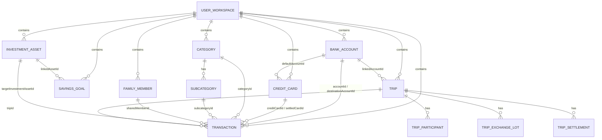

# Documentação Completa do Banco de Dados e Persistência — Minhas Economias BR

## 1. Visão Geral da Persistência (Single Source of Truth — SSOT)

O **Minhas Economias BR** adota uma arquitetura de persistência híbrida **Offline-First + Real-Time Cloud Sync** sobre o **Google Cloud Firestore (Enterprise Edition)** e `localStorage` isolado por cofre de usuário.

- **ID do Banco de Dados Cloud Firestore**: `ai-studio-minhaseconomiasb-70c985b7-075c-4f08-9fdc-96a05658241f`
- **Configuração de Conexão**: Definida em `/firebase-applet-config.json` e inicializada em `/src/firebase.ts`.
- **Blueprint Estrutural**: Definido em `/firebase-blueprint.json`.
- **Regras de Segurança Zero-Trust**: Definidas em `/firestore.rules`.

---

## 2. Estrutura de Coleções no Cloud Firestore

O banco de dados utiliza duas coleções principais que implementam o esquema `UserWorkspace`:

| Caminho da Coleção | Chave do Documento | Finalidade | Regra de Acesso |
| :--- | :--- | :--- | :--- |
| `/workspaces/{userId}` | `request.auth.uid` | Espaço de trabalho vinculado diretamente ao UID de autenticação Firebase do titular | Leitura e escrita exclusivas pelo próprio `request.auth.uid == userId` |
| `/cloud_vaults/{vaultId}` | `vault_usr_<email_normalizado>` | Cofre determinístico em nuvem para sincronização multi-dispositivo e intercâmbio de rateios familiares | Validação de `isValidVaultId` (16 a 64 caracteres), `list: false`, `delete: false`, schema `isValidWorkspace` e imutabilidade de `uid` |

### 2.1. Esquema do Documento Físico (`UserWorkspace`)

Cada documento em `/workspaces/{userId}` ou `/cloud_vaults/{vaultId}` armazena o estado financeiro atômico do usuário, garantindo consistência transacional entre contas, cartões, lançamentos e viagens:

| Campo | Tipo | Obrigatório | Limite Volumétrico (`firestore.rules`) | Descrição |
| :--- | :--- | :---: | :---: | :--- |
| `uid` | `string` | Sim | Igual ao ID do doc | Identificador imutável do cofre/usuário (`data.uid == docId`) |
| `email` | `string` | Não | `<= 200` chars | E-mail do titular da conta (ex: `wesley.diaslima@gmail.com`) |
| `displayName` | `string` | Não | `<= 120` chars | Nome de exibição do titular |
| `updatedAt` | `string` (ISO-8601) | Sim | `1..64` chars | Timestamp ISO da última gravação sincronizada |
| `accountsJson` | `string` (JSON) | Sim | `<= 100.000` chars | Lista serializada de `BankAccount[]` |
| `cardsJson` | `string` (JSON) | Sim | `<= 100.000` chars | Lista serializada de `CreditCard[]` |
| `categoriesJson` | `string` (JSON) | Sim | `<= 150.000` chars | Lista serializada de `Category[]` com `Subcategory[]` |
| `transactionsJson` | `string` (JSON) | Sim | `<= 500.000` chars | Lista serializada de `Transaction[]` |
| `goalsJson` | `string` (JSON) | Sim | `<= 100.000` chars | Lista serializada de `SavingsGoal[]` |
| `investmentsJson` | `string` (JSON) | Sim | `<= 150.000` chars | Lista serializada de `InvestmentAsset[]` |
| `familyMembersJson` | `string` (JSON) | Não | `<= 50.000` chars | Lista serializada de `FamilyMember[]` |
| `investmentTargetsJson`| `string` (JSON) | Não | `<= 10.000` chars | Mapa `InvestmentTargetMap` de alocação-alvo (%) |
| `tripsJson` | `string` (JSON) | Não | `<= 200.000` chars | Lista serializada de `Trip[]` (roteiros, lotes de câmbio e acertos) |
| `settingsJson` | `string` (JSON) | Não | `<= 20.000` chars | Objeto `AppSettings` (preferências, alertas e SMTP) |

---

## 3. Diagrama Entidade-Relacionamento (Domínio Financeiro)

---

## 4. Dicionário de Dados das Entidades do Domínio

### 4.1. `BankAccount` (Contas Bancárias e Contas Globais)
Representa contas correntes, poupanças, reservas em espécie, corretoras ou contas internacionais multi-moeda (Wise, Nomad, C6 Global, Inter Global, Avenue).

| Atributo | Tipo | Obrigatório | Descrição |
| :--- | :--- | :---: | :--- |
| `id` | `string` | Sim | Identificador único (ex: `acc-1793464160549`) |
| `name` | `string` | Sim | Nome de identificação da conta (ex: `Nubank`, `Wise Euro`) |
| `institution` | `string` | Sim | Instituição financeira |
| `type` | `'checking' \| 'savings' \| 'cash' \| 'investment' \| 'international'` | Sim | Modalidade da conta |
| `initialBalance` | `number` | Sim | Saldo inicial de abertura em `BRL` (R$) |
| `color` | `string` | Sim | Cor hexadecimal do cartão/selo da conta |
| `includeInTotal` | `boolean` | Sim | Define se compõe o Saldo Geral de Caixa no Dashboard |
| `currency` | `CurrencyCode` | Não | Moeda nativa da conta (`BRL`, `USD`, `EUR`, `GBP`, etc.) |
| `initialBalanceForeign` | `number` | Não | Saldo inicial na moeda estrangeira quando `type === 'international'` |

---

### 4.2. `CreditCard` (Cartões de Crédito)

| Atributo | Tipo | Obrigatório | Descrição |
| :--- | :--- | :---: | :--- |
| `id` | `string` | Sim | Identificador único do cartão |
| `name` | `string` | Sim | Nome do cartão (ex: `Nubank Ultravioleta`) |
| `brand` | `'Mastercard' \| 'Visa' \| 'Elo'` | Sim | Bandeira do cartão |
| `limit` | `number` | Sim | Limite total de crédito concedido (R$) |
| `closingDay` | `number` (1..28) | Sim | Dia de fechamento da fatura |
| `dueDay` | `number` (1..28) | Sim | Dia de vencimento da fatura |
| `defaultAccountId` | `string` | Sim | FK para `BankAccount.id` padrão de débito da fatura |
| `color` | `string` | Sim | Cor hexadecimal do cartão |

---

### 4.3. `Category` & `Subcategory` (Plano de Contas e Orçamento 50/30/20)

| Atributo | Tipo | Obrigatório | Descrição |
| :--- | :--- | :---: | :--- |
| `id` | `string` | Sim | ID da categoria (ex: `cat-moradia`, `cat-mercado`, `cat-salario`) |
| `name` | `string` | Sim | Nome da categoria principal |
| `type` | `'income' \| 'expense'` | Sim | Natureza contábil |
| `bucket` | `'essential' \| 'lifestyle' \| 'financial'` | Sim | Bloco da regra 50/30/20 (Essenciais, Estilo de Vida, Futuro) |
| `monthlyBudget` | `number` | Sim | Meta de teto mensal de gastos em R$ |
| `color` | `string` | Sim | Cor hexadecimal |
| `icon` | `CategoryIconName` | Sim | Ícone associado |
| `subcategories` | `Subcategory[]` | Sim | Lista de subcategorias (`{ id: string, name: string }`) |

---

### 4.4. `Transaction` (Lançamentos Financeiros, Cartão, Rateios e Câmbio)
Entidade central do razão contábil (Ledger).

| Atributo | Tipo | Obrigatório | Descrição |
| :--- | :--- | :---: | :--- |
| `id` | `string` | Sim | ID único do lançamento (`tx-...` ou `tx-mirror-...`) |
| `description` | `string` | Sim | Descrição comercial ou histórica do lançamento |
| `amount` | `number` | Sim | Valor efetivo em Reais (`BRL`) |
| `date` | `string` (`YYYY-MM-DD`) | Sim | Data do evento ou compra |
| `competenceMonth` | `string` (`YYYY-MM`) | Sim | Mês de competência (mês da fatura para cartão; mês da data para conta) |
| `type` | `'income' \| 'expense' \| 'transfer'` | Sim | Tipo do lançamento |
| `status` | `'paid' \| 'pending'` | Sim | Situação no fluxo de caixa |
| `categoryId` | `string` | Sim | FK para `Category.id` |
| `subcategoryId` | `string` | Não | FK opcional para `Subcategory.id` |
| `accountId` | `string` | Não | FK para `BankAccount.id` (obrigatório em lançamentos de conta/transferência) |
| `destinationAccountId` | `string` | Não | FK para `BankAccount.id` de destino em transferências entre contas |
| `creditCardId` | `string` | Não | FK para `CreditCard.id` em compras no cartão de crédito |
| `paymentMethod` | `'pix' \| 'credit_card' \| 'debit_card' \| 'boleto' \| 'cash' \| 'transfer'` | Sim | Meio de pagamento |
| `recurrence` | `'single' \| 'installment' \| 'fixed'` | Sim | Modalidade de repetição |
| `installmentGroupId` | `string` | Não | ID de agrupamento da série parcelada ou fixa para efeito cascata |
| `installmentNumber` | `number` | Não | Número da parcela atual (`1..N`) |
| `installmentTotal` | `number` | Não | Total de parcelas da compra (`2..48`) |
| `isInvoicePayment` | `boolean` | Não | Indica lançamento bancário de quitação de fatura de cartão |
| `settledCardId` | `string` | Não | FK para `CreditCard.id` cuja fatura foi paga |
| `isAnticipated` | `boolean` | Não | Indica parcela de cartão antecipada com desconto |
| `originalCompetenceMonth` | `string` | Não | Competência original antes da antecipação (permite reversão) |
| `originalAmountBeforeDiscount` | `number` | Não | Valor original da parcela antes do desconto de antecipação |
| `isShared` | `boolean` | Não | Indica despesa compartilhada com membro da família |
| `sharedMemberId` | `string` | Não | FK para `FamilyMember.id` |
| `sharedAmount` | `number` | Não | Valor em R$ correspondente à parte do familiar |
| `sharedPaidBy` | `'me' \| 'member'` | Não | Define quem desembolsou o pagamento (`me` = familiar me deve; `member` = eu devo) |
| `sharedStatus` | `'pending' \| 'received'` | Não | Status do acerto familiar |
| `sharedSyncId` | `string` | Não | Chave de correlação entre cofres de contas familiares vinculadas |
| `targetInvestmentAssetId` | `string` | Não | FK para `InvestmentAsset.id` em aportes diretos |
| `tripId` | `string` | Não | FK para `Trip.id` quando vinculado a um roteiro de viagem |
| `originalCurrency` | `CurrencyCode` | Não | Moeda original do gasto internacional (`EUR`, `USD`, `GBP`, etc.) |
| `originalAmount` | `number` | Não | Valor na moeda estrangeira original |
| `exchangeRate` | `number` | Não | Taxa de câmbio base antes do IOF |
| `iofPercent` | `number` | Não | Alíquota de IOF aplicada (`0%`, `1.1%`, `3.38%`) |
| `effectiveExchangeRate` | `number` | Não | VET (Valor Efetivo Total em R$ por 1 unidade estrangeira) |
| `currencyRegime` | `'global_account' \| 'credit_card_intl' \| 'cash_fx' \| 'brl_direct'` | Não | Regime cambial utilizado |
| `paidByParticipantId` | `string` | Não | Participante da viagem que pagou a despesa (`'me'` ou ID do acompanhante) |
| `tripSplitMethod` | `'equal' \| 'exact' \| 'percentage' \| 'shares' \| 'individual'` | Não | Método de divisão na viagem |
| `tripShares` | `TripExpenseShare[]` | Não | Quotas individuais calculadas para cada participante da viagem |
| `myPersonalShareBrl` | `number` | Não | Parte estritamente pessoal do titular em R$ |
| `isCompanionOnlyExpense` | `boolean` | Não | `true` quando pago por acompanhante (não debita conta bancária do titular) |
| `fitid` | `string` | Não | Identificador único da transação no extrato bancário OFX |
| `reconciled` | `boolean` | Não | Indica que o lançamento foi conciliado com extrato OFX/CSV |

---

### 4.5. `InvestmentAsset` (Ativos da Carteira de Investimentos)

| Atributo | Tipo | Obrigatório | Descrição |
| :--- | :--- | :---: | :--- |
| `id` | `string` | Sim | ID único do ativo |
| `ticker` | `string` | Sim | Código de negociação (ex: `PETR4`, `HGLG11`, `IVVB11`, `TESOURO-SELIC`) |
| `name` | `string` | Sim | Nome descritivo do ativo ou título |
| `assetClass` | `'renda_fixa_pos' \| 'renda_fixa_ipca' \| 'fiis' \| 'acoes_br' \| 'exterior_etf'` | Sim | Classe do ativo para rebalanceamento |
| `institution` | `string` | Sim | Corretora ou banco custodiante |
| `quantity` | `number` | Sim | Quantidade de cotas/ações |
| `averagePrice` | `number` | Sim | Preço médio de aquisição (R$) |
| `currentPrice` | `number` | Sim | Preço unitário atual de mercado (R$) |
| `monthlyYieldPercent` | `number` | Sim | Dividend Yield ou taxa mensal estimada (%) |
| `isTaxExempt` | `boolean` | Sim | Indica isenção de IR sobre rendimentos (ex: FIIs, LCI, LCA) |
| `lastQuoteSyncAt` | `string` | Não | Timestamp ISO da última sincronização com o Google Finance |
| `dailyChangePercent` | `number` | Não | Variação percentual do dia obtida no Google Finance |

---

### 4.6. `Trip`, `TripExchangeLot` & `TripSettlement` (Viagens e Câmbio)

- **`Trip`**: Roteiro com `id`, `name`, `destination`, `startDate`, `endDate`, `status` (`planning`, `active`, `completed`), `currency`, `defaultExchangeRate`, `budgetForeign`, `linkedAccountId`, `participants[]`, `exchangeLots[]` e `settlements[]`.
- **`TripExchangeLot`**: Lote de compra de moeda estrangeira com `foreignAmount`, `rateBase`, `iofPercent`, `effectiveRateBrl` (VET) e `totalBrlPaid`.
- **`TripSettlement`**: Registro de quitação entre participantes da viagem (`fromParticipantId`, `toParticipantId`, `foreignAmountEquivalent`, `brlAmountSettled`, `method`).

---

## 5. Sincronização Entre Contas Familiares (`Cross-Account Sync`)

Quando um usuário vincula o e-mail de um familiar em **Despesas Compartilhadas**:
1. O sistema calcula o `vaultId` determinístico do destinatário (`vault_usr_<email_normalizado>`).
2. Envia um registro de convite (`fam-inv-*`) para o cofre do familiar no Cloud Firestore.
3. Ao registrar despesas compartilhadas (`isShared: true`), o sistema projeta automaticamente lançamentos espelhados (`tx-mirror-*`) no cofre do familiar com `sharedPaidBy` invertido (`'me'` $\leftrightarrow$ `'member'`), mantendo ambos os lados sincronizados em tempo real via `onSnapshot`.

---

## 6. Regras de Integridade e Auditoria Contábil Automática (`SSOT`)

O módulo `runFinancialIntegrityAudit` (`src/utils/travelRules.ts`) valida continuamente 7 invariantes de banco de dados:
1. **Isolamento e Persistência em Nuvem**: Nenhum dado fictício/mock residual (`isLegacyMockRecord === false`).
2. **Integridade Referencial de Contas e Cartões**: Nenhum lançamento órfão apontando para conta ou cartão inexistente.
3. **Partidas Dobradas em Transferências e Aportes**: Toda transferência possui origem e destino distintos ou ativo de investimento válido.
4. **Precisão de Parcelamentos e Faturas**: Soma exata das parcelas sem perda de centavos e baixa consistente de faturas.
5. **Matemática Cambial (VET + IOF)**: Consistência entre valor em moeda estrangeira, taxa efetiva e valor em Reais.
6. **Encontro de Contas Familiar e Splitwise**: Rateios nunca excedem 100% do valor original da despesa.
7. **Vinculação de Viagens e Contas Internacionais**: Despesas pagas por acompanhantes (`isCompanionOnlyExpense`) entram no Splitwise da viagem sem debitar o saldo bancário pessoal do titular.
