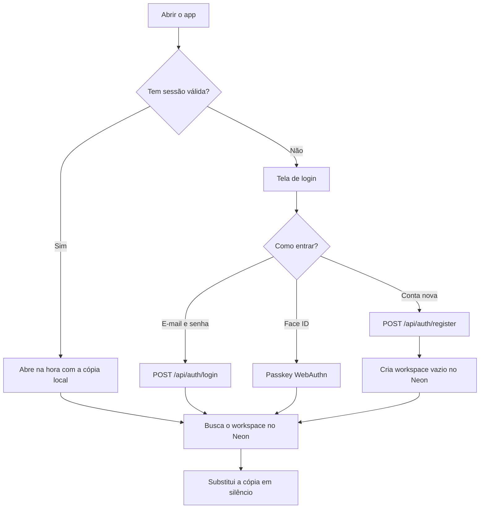
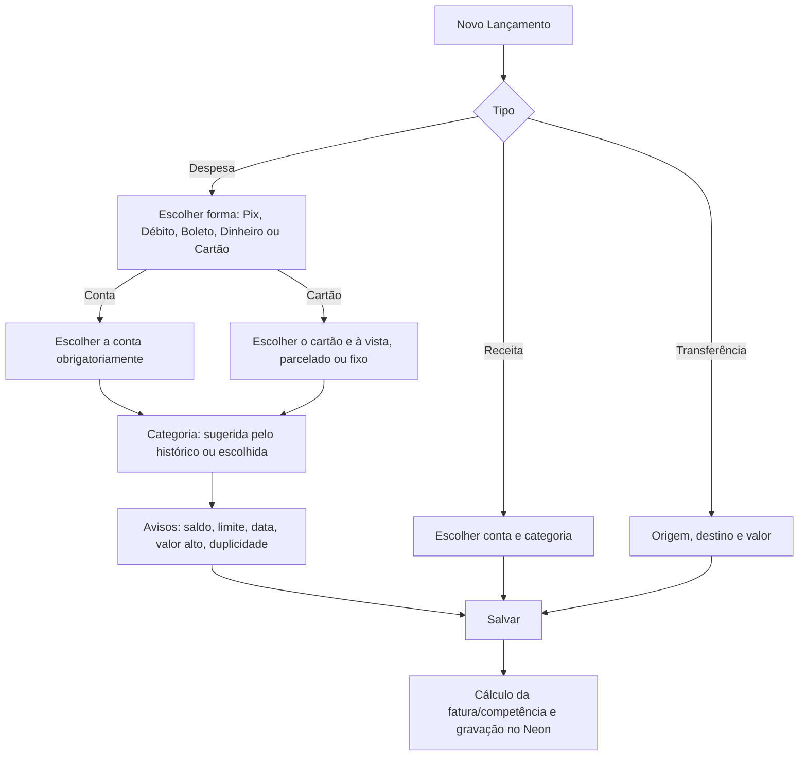
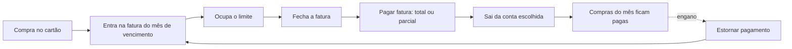
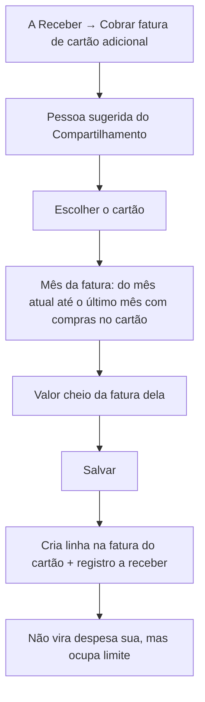
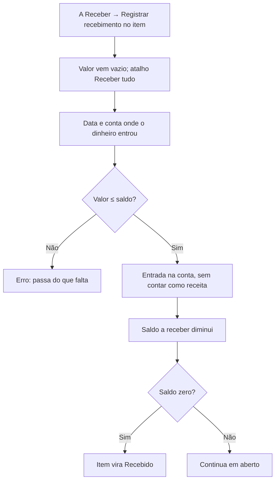

# Fluxos do sistema

Passo a passo das operações principais, do ponto de vista de quem usa, com o que o sistema faz por baixo. As regras de cálculo estão em [regras-de-negocio.md](./regras-de-negocio.md).

---

## 1. Entrar no sistema


- Sessão dura 30 dias; **Sair da Conta** revoga todas as sessões da conta (versão do token).
- No computador o Face ID não é oferecido; no celular o banner oferece cadastrar o rosto.
- Conta nova: não há verificação de e-mail. Vínculo familiar só por convite dentro do sistema.

## 2. Criar um lançamento


- Nada vem pré-selecionado quando há mais de uma opção. Com uma só opção (ex.: uma conta) ela já vem marcada.
- O valor digitado segue a máscara de centavos.
- Para um estabelecimento conhecido, o app sugere categoria e de onde costuma sair o dinheiro.
- Se a categoria tem **divisão automática** (Configurações), o lançamento já vem dividido com a pessoa.

## 3. Compra no cartão até pagar a fatura


- Gasto conta no **mês da compra**; o dinheiro sai da conta no **mês do pagamento** da fatura.
- Pagamento parcial divide a compra que ficar no meio e mantém o resíduo pendente.
- Antecipar parcelas: traz parcelas futuras para a fatura atual com desconto e pode ser revertido com 1 clique.

## 4. Mudar o fechamento de um cartão

1. Cartões → abrir o cartão → **Editar Cartão**.
2. Ajustar **Dia fecha** e/ou marcar "Compra no próprio dia do fechamento vai para a próxima fatura".
3. Ao salvar, as compras **pendentes** feitas exatamente no dia do fechamento mudam de fatura sozinhas. Parceladas, pagas e ajustes manuais não mudam.

## 5. Cobrar fatura de cartão adicional (ex.: da esposa)



## 6. Receber (parcial ou total)


- **Desfazer recebimento** e **Apagar** estão no próprio item (apagar com cartão cuja fatura já foi paga é bloqueado).

## 7. Dívida de pessoa (empréstimo)

A Receber → **Empréstimo / dívida**: pessoa, valor, data; opcionalmente a conta de onde o dinheiro saiu. Sem prazo. Cada pagamento que a pessoa fizer é registrado como recebimento (fluxo 6).

## 8. Compartilhar uma despesa e fazer o acerto

1. Ao lançar, marcar compartilhado, escolher a pessoa, quem pagou e a divisão (ou deixar a regra por categoria fazer isso).
2. Em **Compartilhado**, conferir saldo por pessoa no mês.
3. **Fazer acerto**: o sistema compensa créditos e débitos e gera um único lançamento bancário.
4. **Reabrir acerto** estorna o lançamento se foi engano.
5. Entre contas diferentes: enviar **convite**; depois de aceito, despesas compartilhadas espelham na outra conta pelo servidor.

## 9. Importar extrato OFX/CSV

1. Baixar o extrato OFX/CSV no app ou site do banco.
2. Extrato → **Importar Extrato OFX** (ou Contas → **Importar OFX nesta conta**).
3. Conferir as linhas lidas: duplicadas são marcadas; pendentes existentes são quitadas em vez de duplicar; linhas de fatura de cartão usam a cascata de quitação.
4. Confirmar. O app aprende a categoria usual de cada estabelecimento.

## 10. Investimento

Investimentos → aporte/resgate informando conta, ativo, quantidade e preço → vira **transferência** conta ↔ ativo. Proventos viram receita. Atualizar cotações busca B3/Google Finance.

## 11. Viagem com câmbio

Criar viagem → participantes → **lote de câmbio** (compra de moeda, gera saída da conta) → registrar gastos na moeda local (convertidos pelo VET) → dividir entre participantes → **quitar** dívidas simplificadas.

## 12. Backup e restauração do workspace

Configurações → Backup → **Exportar JSON** (guarde fora do aparelho). Para restaurar: escolher o arquivo, confirmar a substituição e **aguardar a nuvem confirmar a gravação**. Detalhes em [../operacao/backup-e-restauracao.md](../operacao/backup-e-restauracao.md).

## 13. Atualizar o aplicativo (PWA)

O app procura versão nova a cada 10 min, ao voltar à aba e ao reconectar. A atualização só é aplicada sem campo alterado, janela aberta ou gravação em andamento. Manualmente: Conta, Login & Nuvem → **Buscar atualização agora**.

## 14. Sincronização entre aparelhos

```mermaid
sequenceDiagram
    participant A as Aparelho A
    participant S as Servidor/Neon
    participant B as Aparelho B
    A->>S: PUT workspace (revisão esperada N)
    S-->>A: 200 (revisão N+1)
    B->>S: consulta revisão (polling leve)
    S-->>B: revisão N+1
    B->>S: GET workspace
    B->>B: troca os dados em silêncio (sem aviso)
    Note over A,B: Se A e B gravarem juntos: o primeiro vence; o outro recebe 409 e atualiza.
```
