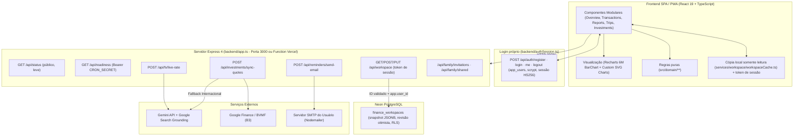

# API REST — Minhas Economias

> Descreve as rotas do servidor (`backend/app.ts`). Para visão geral de arquitetura veja [arquitetura.md](./arquitetura.md); para as regras de cálculo, [../produto/regras-de-negocio.md](../produto/regras-de-negocio.md). Atualizado em 2026-11-15.

## 1. Visão geral (diagrama)

O projeto opera em arquitetura unificada **Node.js + Express 4 + React 19 (Vite)**:



---

## 2. Especificação da API REST (`backend/app.ts`)

### 2.1. `GET /api/status` e `GET /api/readiness`

`GET /api/status` é público e informa somente se a API e as configurações
necessárias estão presentes. Não abre conexão nem executa consultas no Neon;
`services.neon: "not_checked"` significa que a disponibilidade do banco não
foi medida. O diagnóstico da interface combina esse estado com o estado real da
última sincronização.

`GET /api/readiness` verifica a conexão, a tabela operacional e os privilégios
da role do Neon. Exige `Authorization: Bearer <CRON_SECRET>` e retorna `401`
antes de conectar ao banco quando o segredo está ausente ou não corresponde.
O cron diário da Vercel aponta para essa rota e envia o bearer secret configurado
no ambiente do projeto.

- **Resposta `200 OK`**:
```json
{
  "status": "ok",
  "environment": "development",
  "geminiConfigured": true,
  "services": {
    "liveFxSearch": true,
    "googleFinanceSync": true,
    "authConfigured": true,
    "neonConfigured": true,
    "neon": "not_checked"
  },
  "checkedAt": "2026-10-31T16:50:00.000Z"
}
```

### 2.2. Rotas autenticadas do workspace Neon

Todas exigem `Authorization: Bearer <token de sessão>`. A API valida a
assinatura HS256 e a expiração do token e confere o `token_version` em
`app_users` a cada requisição (logout revoga todos os tokens anteriores); depois
aplica o ID verificado no contexto RLS da transação PostgreSQL. Sessão inválida,
expirada ou revogada retorna `401`; falha ao consultar o banco ou segredo ausente
retorna `503`.

- `GET /api/workspace`: carrega o snapshot da conta autenticada; retorna `404`
  quando ainda não há linha para a conta.
- `POST /api/workspace`: cria o workspace inicial usando `INSERT ... ON CONFLICT DO NOTHING`, sem substituir dados existentes.
- `PUT /api/workspace`: salva com `expectedRevision`; conflito retorna `409`.

Se a conta ainda não tiver workspace, o registro inicial é criado no Neon.
Convites e lançamentos compartilhados usam tabelas Neon próprias.

### 2.2.1. Autenticação (`/api/auth/*`)

| Rota | Acesso | Função |
|---|---|---|
| `POST /api/auth/register` | público, 10 tentativas/h por IP | Cria conta (`{email, password, name?}`; senha 8–200 caracteres). `201` com `{token, user}`; `409` se o e-mail já existe |
| `POST /api/auth/login` | público, 8 falhas/15 min por IP+e-mail | `200` com `{token, user}`; `401` e-mail/senha incorretos; `429` bloqueio temporário |
| `GET /api/auth/me` | sessão | Revalida a sessão e devolve novo token e dados da conta |
| `POST /api/auth/logout` | sessão | Incrementa `token_version` (revoga todos os tokens); `204` |
| `GET /api/auth/passkeys` | sessão | Lista os aparelhos com Face ID da conta (`{passkeys:[{id,label,createdAt,lastUsedAt}]}`) |
| `POST /api/auth/passkeys/register/options` · `register/verify` | sessão | Cadastra o Face ID do aparelho (WebAuthn, atestação `none`, verificação biométrica obrigatória, até 10 por conta). O desafio viaja em token assinado de 5 min (`challengeToken`) |
| `DELETE /api/auth/passkeys/:id` | sessão | Remove o Face ID de um aparelho; `204` |
| `POST /api/auth/passkeys/login/options` · `login/verify` | público, 20 falhas/15 min por IP | Entra só com o rosto (passkey sem e-mail). `200` com `{token, user}`; `401` se a assinatura, o desafio ou o domínio não conferem |

Sem verificação de e-mail: o convite familiar dentro do sistema é o vínculo entre contas.

### 2.2.2. Família e compartilhamento (`/api/family/*`, sessão obrigatória)

- `GET/POST /api/family/invitations`: lista e cria convites.
- `POST /api/family/invitations/:invitationId/respond` e `/revoke`: aceitar/recusar e revogar (`404` convite inexistente para a conta; `409` convite já respondido).
- `GET/PUT /api/family/shared`: lê e sincroniza despesas compartilhadas (cota validada em centavos; `400` se inválida).

---

### 2.3. `POST /api/fx/live-rate`
Consulta a cotação comercial em tempo real de uma moeda estrangeira (`USD`, `EUR`, `GBP`, `CAD`, `CHF`, `ARS`, `CLP`, `JPY`) frente ao Real Brasileiro (`BRL`) usando **Gemini Google Search Grounding**.

- **Payload de Requisição**:
```json
{
  "currency": "EUR"
}
```
- **Resposta `200 OK`**:
```json
{
  "currency": "EUR",
  "targetCurrency": "BRL",
  "commercialRateBrl": 6.1845,
  "summaryText": "Cotação comercial atual: 1 EUR = R$ 6,1845.",
  "fetchedAt": "2026-10-31T16:50:00.000Z",
  "sources": [
    {
      "uri": "https://www.google.com/finance/quote/EUR-BRL",
      "title": "EUR/BRL - Google Finance"
    }
  ]
}
```

---

### 2.4. `POST /api/investments/sync-quotes`
Sincroniza em lote (até 20 tickers por requisição) os preços atuais de mercado e a variação diária (`%`) de Ações B3, FIIs e ETFs diretamente do **Google Finance (`:BVMF`)**, com fallback via **Google Search Grounding** para ativos internacionais.

- **Payload de Requisição**:
```json
{
  "tickers": ["PETR4", "HGLG11", "IVVB11"]
}
```
- **Resposta `200 OK`**:
```json
{
  "quotes": [
    {
      "ticker": "PETR4",
      "priceBrl": 38.45,
      "changePercent": 1.25,
      "name": "Petróleo Brasileiro S.A. - Petrobras",
      "sourceUri": "https://www.google.com/finance/quote/PETR4:BVMF?hl=pt-BR"
    }
  ],
  "fetchedAt": "2026-10-31T16:50:00.000Z",
  "sources": []
}
```

---

### 2.5. `POST /api/reminders/send-email`
Dispara o resumo diário/semanal/mensal de pendências financeiras e vencimentos de faturas utilizando as credenciais SMTP fornecidas pelo usuário (`nodemailer`). Exige sessão (`Authorization: Bearer <token de sessão>`), restringe destinos a hostnames públicos e portas SMTP compatíveis, e exige TLS. As credenciais podem estar incluídas nas configurações persistidas no Neon. Responde `502` se o servidor SMTP recusar a entrega.

- **Payload de Requisição**:
```json
{
  "to": "usuario@exemplo.com",
  "subject": "[Minhas Economias BR] Resumo de Vencimentos",
  "textBody": "Resumo em texto puro...",
  "htmlBody": "<div>Resumo HTML...</div>",
  "recurrence": "daily",
  "preferredTime": "08:00",
  "smtp": {
    "host": "smtp.gmail.com",
    "port": 587,
    "user": "usuario@exemplo.com",
    "pass": "app_password_16_chars",
    "secure": false
  }
}
```

---

## 3. Onde ficam as regras de negócio

As regras vivem em `src/domain/` (puras, sem React) e estão descritas em [../produto/regras-de-negocio.md](../produto/regras-de-negocio.md). Mapa rápido:

| Assunto | Arquivos |
|---|---|
| Lançamentos, contas, faturas, resultado, patrimônio, DRE, busca global, simulador de renda fixa | `src/domain/finance/financeRules.ts` (+ `transferRules`, `spendingGuards`, `categoryCatalog`, `categoryMatching`, `accountLabels`, `transactionDeletion`) |
| Cartões | `src/domain/cards/cardCommitment.ts`, `cardIntelligence.ts` |
| Orçamentos, previsão de caixa, aprendizado, recorrência, saúde dos dados, antecipação de parcelas | `src/domain/budgets/*` |
| A Receber | `src/domain/receivables/receivables.ts` |
| Compartilhado | `src/domain/family/sharedFinanceRules.ts`, `sharedSettlementReceipts.ts` |
| Viagens e câmbio | `src/domain/trips/travelRules.ts` |
| Investimentos e cotações | `src/domain/investments/investmentRules.ts` |
| Lembretes e avisos do sino | `src/domain/reminders/reminderRules.ts`, `appNotices.ts` |
| Cópia local, payload, sessão, recuperação de sincronização, backup JSON (versões 3 a 6) | `src/services/workspace/*` |
| OFX/CSV, relatórios PDF | `src/services/import-export/*` |
| Atualização silenciosa do PWA | `src/pwa/updateGate.ts` |

---

## 4. Testes e CI

- Local: `bun run check` (lint, testes, build e checagem do HANDOFF). Detalhes em [testes-e-qualidade.md](./testes-e-qualidade.md).
- `.github/workflows/ci.yml`: job `postgres` (PostgreSQL 17 real com `scripts/qa-postgres.ts`: API, RLS, acertos, readback e revisão concorrente) e job `verify` (lint, suíte completa e build).
- `.github/workflows/neon-daily-activity.yml` (12:23 UTC, `SELECT 1`) e `neon-backup.yml` (13:17 UTC, dump cifrado com `age`, retenção de 30 dias). Veja [../operacao/backup-e-restauracao.md](../operacao/backup-e-restauracao.md).
