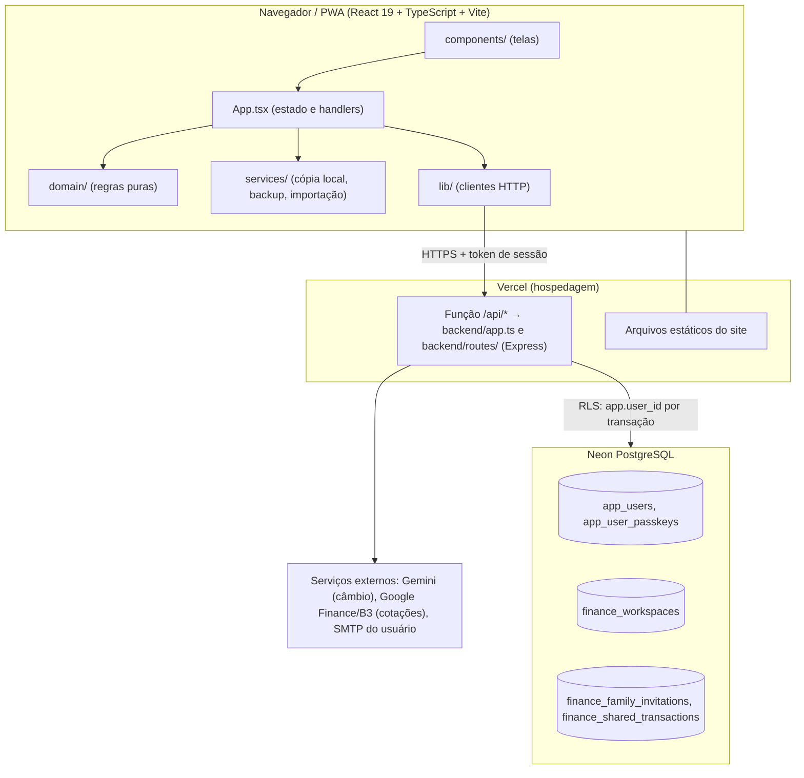

# Arquitetura

## Visão geral

## Camadas

| Camada | Responsabilidade | Código |
|---|---|---|
| Interface | Telas, formulários, navegação, acessibilidade | `src/components`, `src/hooks`, `src/index.css` |
| Orquestração | Estado do workspace, handlers, sincronização, desfazer | `src/App.tsx` e hooks em `src/app/`, `src/services/workspace` |
| Regras de negócio | Cálculos e decisões puras, testáveis sem tela | `src/domain` |
| Acesso a dados (cliente) | Chamadas à API, cópia local somente leitura | `src/lib`, `src/services` |
| API | Autenticação, workspace, família, câmbio, cotações, e-mail | `backend/app.ts` e `backend/routes/` (+ `api/` na Vercel) |
| Banco | Persistência e isolamento por usuário | Neon PostgreSQL + `db/migrations` |

## Decisões de arquitetura permanentes

1. **Workspace único em JSONB** (`finance_workspaces.payload`): um documento por usuário com todas as coleções. Reduz risco de migração; lançamentos não são linhas individuais. Campos: `accountsJson`, `cardsJson`, `categoriesJson`, `transactionsJson`, `goalsJson`, `investmentsJson`, `investmentTargetsJson`, `tripsJson`, `familyMembersJson`, `receivablesJson`, `settingsJson`, etc.
2. **Neon é a única fonte de verdade**. O aparelho tem só uma cópia de leitura para abrir rápido; nada é gravado antes de o Neon ser lido.
3. **Revisão otimista**: gravação com `expectedRevision`; conflito vira `409`. Primeiro a gravar vence; as demais telas atualizam em silêncio.
4. **Login próprio** (e-mail + senha com scrypt; sessão HS256 de 30 dias com `token_version`; Face ID por WebAuthn). Sem Firebase, sem verificação de e-mail.
5. **Isolamento no banco (RLS)**: cada transação PostgreSQL define `app.user_id`/`app.user_email`; o frontend nunca vê `DATABASE_URL`.
6. **Regras de dinheiro centralizadas** em `src/domain` — telas só exibem e disparam handlers.
7. **Um dado novo no workspace não exige migração SQL**: basta um campo opcional no payload, validado pelo servidor (`receivablesJson` foi assim).

## Fluxo de dados de uma gravação

1. Ação do usuário → handler em `App.tsx` calcula o novo estado usando funções de `domain`.
2. `App.tsx` monta o payload (`buildCloudPayload`) e envia por `lib/neonWorkspace.ts` (`PUT /api/workspace` com a revisão esperada).
3. O servidor valida sessão e campos, aplica RLS e grava; devolve a nova revisão.
4. Outros aparelhos percebem a revisão nova (`GET /api/workspace/revision`) e substituem os dados em silêncio.

## PWA e atualização
- Service worker gerado por `vite-plugin-pwa`; `sw.js` nunca é cacheado (cabeçalho em `vercel.json`).
- `src/pwa/updateGate.ts` decide quando é seguro aplicar a atualização (sem edição em andamento).

## Tecnologias
React 19, TypeScript 7, Vite 8, Tailwind v4, Lucide, Recharts, jsPDF, Express 4, `pg`, `@simplewebauthn`, Nodemailer, `@google/genai`; testes com `bun test` + happy-dom. Gerenciador de pacotes: bun.
